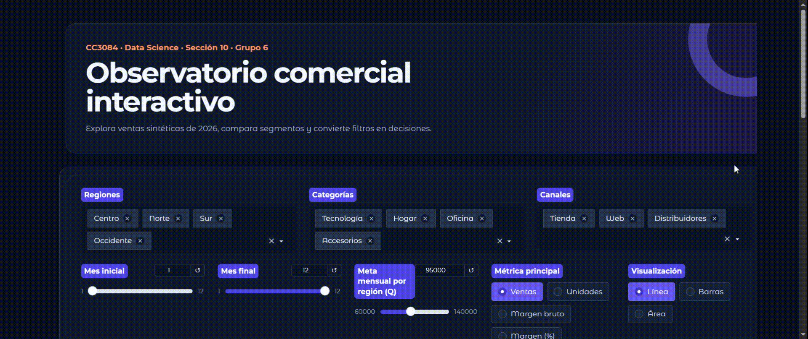

# Observatorio comercial interactivo con Gradio

**CC3084 · Data Science · Sección 10 · Grupo 6**<br>
Universidad del Valle de Guatemala · Segundo semestre de 2026<br>
Pablo Daniel Barillas Moreno — Carné No. 222193<br>
Carlos Aldana — Carné No. 23394

Proyecto académico sobre herramientas para dashboards interactivos, con Gradio como tecnología principal. La entrega combina investigación, presentación HTML, informe PDF reproducible y una aplicación funcional construida con Python, Gradio, pandas y Plotly.

## Demo

<p align="center">
  
</p>

La animación muestra el flujo principal de `app.py`: exploración de filtros, actualización de indicadores y navegación por las vistas analíticas.

## Qué incluye la aplicación

- 576 observaciones sintéticas reproducibles: 12 meses, 4 regiones, 4 categorías y 3 canales.
- Filtros multidimensionales y rango de meses coordinado.
- Cambio de métrica entre ventas y unidades, y de visualización entre línea, barras y área.
- Cinco KPIs: ventas, crecimiento, margen bruto, ticket promedio y cumplimiento de meta.
- Cuatro vistas analíticas: tendencia, composición por categoría, comparación regional y mapa de calor.
- Hallazgos automáticos, tabla detallada y descarga del subconjunto filtrado en CSV.
- Diseño oscuro responsivo, contenido centrado y controles legibles en escritorio y móvil.

## Instalación en Windows

```powershell
git clone https://github.com/DanielBarillasM/Gradio_Grupo-6_Data-Science_Sec-10.git
cd Gradio_Grupo-6_Data-Science_Sec-10
py -m venv .venv
.\.venv\Scripts\Activate.ps1
python -m pip install --upgrade pip
python -m pip install -r requirements.txt
```

Instalación mínima de Gradio, si solo se desea probar un ejemplo básico:

```powershell
python -m pip install --upgrade gradio
```

Si PowerShell bloquea la activación del entorno:

```powershell
Set-ExecutionPolicy -Scope Process -ExecutionPolicy Bypass
.\.venv\Scripts\Activate.ps1
```

## Ejecutar y probar

```powershell
python app.py
```

Abrir <http://127.0.0.1:7860>. Para desarrollo con recarga automática:

```powershell
gradio app.py
```

Ejecutar la suite de pruebas:

```powershell
python -m unittest discover -s tests -v
```

Crear un enlace público temporal, únicamente con datos aptos para ser públicos:

```powershell
python app.py --share
```

## Presentación HTML

La presentación tiene 15 diapositivas y navegación por flechas, barra espaciadora, botones o gestos táctiles. Con el dashboard activo, iniciar un servidor estático en otra terminal:

```powershell
python -m http.server 8000 --bind 127.0.0.1
```

Abrir <http://127.0.0.1:8000/presentacion_gradio.html>.

## Informe LaTeX y PDF

El archivo `informe_gradio.tex` se compila con XeLaTeX para conservar tipografía Unicode y enlaces activos:

```powershell
latexmk -xelatex -interaction=nonstopmode -halt-on-error informe_gradio.tex
```

Alternativamente, ejecutar `xelatex informe_gradio.tex` dos veces. El PDF entregado ya está compilado como `informe_gradio.pdf`.

## Estructura

| Archivo | Contenido |
|---|---|
| `Demo.gif` | Recorrido animado por el flujo principal del dashboard. |
| `app.py` | Aplicación, dataset sintético, filtros, indicadores y visualizaciones. |
| `Ejemplo.py` | Ejemplo mínimo o “hello world” con `gr.Interface`. |
| `tests/test_app.py` | Cuatro pruebas de cobertura, filtrado, contrato de salida y exportación. |
| `presentacion_gradio.html` | Presentación visual e interactiva autocontenida. |
| `informe_gradio.tex` / `.pdf` | Informe académico completo y versión compilada. |
| `INVESTIGACION.md` | Síntesis, referencias y guion para la exposición. |
| `assets/dashboard_final.png` | Captura validada de la aplicación. |
| `requirements.txt` | Dependencias reproducibles. |

## Decisiones operativas

La aplicación limita a cuatro ejecuciones concurrentes por evento y a 10 MB por archivo. Para producción deben añadirse autenticación, HTTPS, gestión externa de secretos, límites de recursos y observabilidad. Los enlaces `share=True` son adecuados para demostraciones temporales, no para alojar información sensible.
